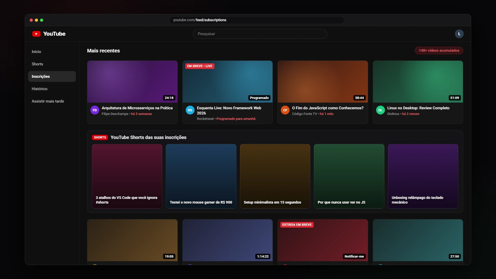

<div align="center">
  

  # ZeroSub
  *Transforme a aba de Inscrições do YouTube em uma fila estilo Inbox Zero com triagem rápida em cada card.*

  [](https://developer.chrome.com/docs/extensions/develop/migrate/what-is-mv3) [](https://github.com/lucasfsilva94/ZeroSub) [](https://developer.mozilla.org/en-US/docs/Web/JavaScript) [](content/styles.css) [](#-testes-e-qualidade)

  [Projeto](#-projeto) • [Funcionalidades](#️-funcionalidades) • [Estrutura](#-estrutura-do-repositório) • [Instalação](#-instalação) • [Fluxo OpenSpec](#-fluxo-spec-driven-openspec) • [Testes](#-testes-e-qualidade)

  <br />

  
</div>

---

## 🧩 Projeto

**ZeroSub** é uma extensão para Google Chrome (Manifest V3) que transforma a página de inscrições do YouTube (`https://www.youtube.com/feed/subscriptions`) em uma fila limpa no estilo **Inbox Zero**.

Ao instalar a extensão, um **Marco Zero (`installTimestamp`)** é definido automaticamente: todo o histórico antigo fica oculto e apenas vídeos publicados a partir daquele momento entram na sua fila, acompanhados de botões integrados em cada card para **marcar como visto** ou **cancelar a inscrição do canal** sem sair do feed.

---

## ⚙️ Funcionalidades

- **Marco Zero (`installTimestamp`):** Registra o timestamp exato na instalação e oculta automaticamente vídeos anteriores na aba `/feed/subscriptions`, preservando o marco em atualizações da extensão.
- **Triagem Rápida por Card:**
  - **Marcar como Visto (`✓ Visto`):** Remove o vídeo da fila com transição suave de colapso e persiste o `videoId` em `chrome.storage.local` (até 5.000 IDs em fila FIFO).
  - **Marcação Automática (`>90%`):** Monitora o player HTML5 em páginas `/watch` e marca automaticamente o vídeo como visto ao atingir 90% da duração.
  - **Desinscrição em 2 Cliques (`Desinscrever` -> `Confirmar?`):** Primeiro clique ativa o estado de confirmação (com reset automático em 4s). O segundo clique cancela a inscrição diretamente via API interna do YouTube (`SAPISIDHASH` + `INNERTUBE_API_KEY`) com fallback UI e oculta todos os cards daquele canal na hora.
- **Filtros de Formato:** Oculta prateleiras e cards de **YouTube Shorts** (`/shorts/`) e **transmissões ao vivo agendadas/estreias futuras**, mantendo visíveis lives em andamento ou já encerradas.
- **Barra de Controle no Topo & Popup Dashboard:**
  - Contador em tempo real de vídeos pendentes na fila (refletido também no badge do ícone da extensão).
  - Alternância instantânea entre **Modo ZeroSub** e **Mostrar todos**.
  - Botão **Zerar Feed Agora / Zerar tudo agora** para redefinir o Marco Zero para o momento atual (`Date.now()`).
  - Botão **Restaurar vídeos ocultos** para recuperar vídeos dispensados manualmente por engano.
- **Integração Nativa com a SPA do YouTube:** Suporte completo à navegação sem reload (`yt-navigate-finish`), carregamento por rolagem infinita (`MutationObserver` + interceptação de `/youtubei/v1/browse`), parser temporal bilíngue (`PT-BR` e `EN-US`) e temas Claro/Escuro (`html[dark]`).

---

## 📁 Estrutura do Repositório

```text
zeroSub/
├── content/
│   ├── injector.js             # Content script (MAIN world): ytInitialData, interceptação /browse e InnerTube unsubscribe
│   ├── content.js              # Content script (ISOLATED world): parser PT-BR/EN-US, filtros DOM, barra superior e botões nos cards
│   └── styles.css              # Estilização adaptativa aos temas Claro e Escuro (html[dark]) do YouTube
├── icons/
│   ├── icon-16.png             # Ícone 16x16 da extensão
│   ├── icon-32.png             # Ícone 32x32 da extensão
│   ├── icon-48.png             # Ícone 48x48 da extensão
│   └── icon-128.png            # Logo oficial 128x128 da extensão
├── popup/
│   ├── popup.html              # Estrutura do Popup Dashboard
│   ├── popup.js                # Lógica reativa de contadores, reset, restauração e toggles
│   └── popup.css               # Estilos minimalistas do painel popup
├── openspec/
│   ├── config.yaml             # Configuração do fluxo Spec-Driven
│   ├── specs/                  # Especificações principais consolidadas (feed-baseline-filtering, video-card-triage, popup-dashboard)
│   └── changes/
│       └── archive/
│           └── 2026-11-18-zerosub-chrome-extension/
│               ├── proposal.md # Proposta de valor, escopo e capacidades
│               ├── design.md   # Arquitetura técnica e decisões de design
│               ├── tasks.md    # Plano de implementação verificado
│               └── specs/      # Delta specs originais da entrega
├── tests/
│   └── zerosub.test.js         # Suíte de testes unitários e de integração (Node.js Test Runner)
├── background.js               # Service Worker (Manifest V3): estado inicial e badge de pendentes
├── manifest.json               # Manifesto da extensão Chrome (MV3)
└── README.md                   # Documentação do projeto
```

---

## 🚀 Instalação

A extensão é escrita em Vanilla JavaScript/CSS sem necessidade de etapa de build, podendo ser carregada diretamente no navegador:

1. Clone este repositório:
   ```bash
   git clone https://github.com/lucasfsilva94/ZeroSub.git
   ```

2. Abra o Google Chrome e acesse na barra de endereços:
   ```text
   chrome://extensions/
   ```

3. No canto superior direito, ative a chave **Modo do desenvolvedor** (*Developer mode*).

4. Clique em **Carregar sem compactação** (*Load unpacked*).

5. Selecione a pasta raiz do projeto (`zeroSub`).

6. Acesse sua página de inscrições do YouTube ([https://www.youtube.com/feed/subscriptions](https://www.youtube.com/feed/subscriptions)) para ver o **ZeroSub** em ação.

---

## 📋 Fluxo Spec-Driven (OpenSpec)

O projeto segue o fluxo **Spec-Driven** com o **[OpenSpec](https://github.com/Fission-AI/OpenSpec)**. Toda nova funcionalidade ou alteração comportamental nasce como uma *change* estruturada em [`openspec/changes/`](openspec/changes/) antes de ser implementada e consolidada nas especificações principais em [`openspec/specs/`](openspec/specs/).

### ⚡ Ordem dos Comandos no Fluxo

| Ordem | Comando | O que faz | Artefatos / Destino |
|---|---|---|---|
| **1** *(opcional)* | `/opsx:explore <tema>` | Modo de exploração e investigação de ideias, problemas e arquitetura antes de abrir uma change formal | Discussão técnica / análise |
| **2** | `/opsx:propose <descrição>` | Cria a change e gera todos os artefatos de planejamento de uma só vez (`proposal.md`, delta `specs/`, `design.md` e `tasks.md`) | `openspec/changes/<change>/` |
| **3** | `/opsx:apply` | Executa as tarefas pendentes de `tasks.md` em ordem de dependência, roda as verificações de cada entrega e marca os checkboxes (`- [x]`) em tempo real | Código-fonte + `tasks.md` |
| **4** | `/opsx:verify` | Audita a implementação contra os artefatos em 3 dimensões (**Completeness**, **Correctness** e **Coherence**), mapeando requisitos, cenários e aderência ao design | Relatório de verificação |
| **5** | `/opsx:archive` | Valida a conclusão de todos os artefatos e tarefas, sincroniza as *delta specs* em `openspec/specs/` e move a change finalizada para o histórico | `openspec/changes/archive/YYYY-MM-DD-<change>/` |

## 🧪 Testes e Qualidade

A suíte automatizada utiliza o runner nativo do Node.js (`node --test`) e valida o `manifest.json`, a inicialização idempotente do `background.js`, a extração de metadados e cálculo `SAPISIDHASH` do `injector.js`, o parser de datas relativas (`PT-BR` e `EN-US`), as regras de filtragem de cards e o funcionamento do popup.

Execute todos os testes com:

```bash
node --test tests/zerosub.test.js
```
